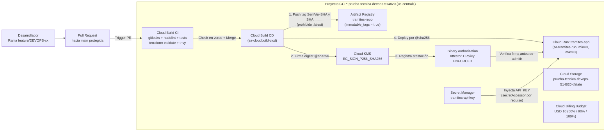

# Plataforma de Despliegue — Consulta de Estado de Trámite (GOES)

Solución a la **Prueba Técnica: Ingeniero DevOps Senior** (Gerencia de SRE, Dirección de Transformación Digital e Innovación).

- **ID del proyecto GCP:** `prueba-tecnica-devops-514820`
- **Opción elegida en Parte B:** **Opción 1 — Binary Authorization** (con firma criptográfica asimétrica en Cloud KMS).
- **URL del servicio en vivo (Cloud Run):** https://tramites-app-sl5swoiaha-uc.a.run.app
  - Healthcheck: [`GET /health`](https://tramites-app-sl5swoiaha-uc.a.run.app/health)
  - Consulta de trámite: [`GET /api/tramites/TR-000123`](https://tramites-app-sl5swoiaha-uc.a.run.app/api/tramites/TR-000123) (`TR-000123`, `TR-000456`, `TR-000789`, `TR-000999`)
- **Respuestas de criterio (Parte C):** [CRITERIO.md](./CRITERIO.md)

---

## 1. Diagrama de Arquitectura



---

## 2. Estructura del Repositorio

```text
.
├── app/                          # Aplicación Node.js 24 (Express 5) + UI React 19 (Vite)
│   ├── server/                   # API (/health, /api/tramites/:id) y tests unitarios
│   ├── web/                      # Interfaz ciudadana en React para consultar trámites
│   ├── Dockerfile                # Multistage (3 etapas), runtime distroless nonroot (UID 65532)
│   └── package.json
├── cloudbuild/
│   ├── ci.yaml                   # Pipeline CI en Pull Requests
│   └── cd.yaml                   # Pipeline CD en main (build, push, trivy, KMS attest, deploy, smoke test)
├── infra/
│   ├── bootstrap/                # Habilitación de APIs y bucket GCS para el estado remoto
│   └── platform/                 # Artifact Registry, Cloud Run, Secret Manager, IAM, KMS, BinAuthz, Budget
├── .env.example                  # Plantilla de variables de entorno sin valores reales
├── .gitignore                    # Bloquea .env, llaves JSON, tfvars y tfstate
├── CRITERIO.md                   # Parte C: Golden Path, conectividad híbrida y control de costos
└── README.md                     # Este documento
```

---

## 3. Cómo Desplegar Desde Cero

### Prerrequisitos
- `git`, `node >= 24`, `gcloud` y `terraform >= 1.11` instalados.
- Proyecto de GCP con facturación activa y sesión iniciada sin llaves JSON:
  ```powershell
  gcloud auth login
  gcloud auth application-default login
  gcloud config set project <TU_PROJECT_ID>
  ```

### Paso 1: Desarrollo y pruebas en local (opcional)
```powershell
Copy-Item .env.example .env
cd app
npm ci
npm test
npm run dev   # Levanta Express (:8080) y React/Vite (:5173) simultáneamente
```

### Paso 2: Bootstrap del estado remoto en GCS
Habilita las dos APIs base de administración y aplica el módulo `infra/bootstrap`:
```powershell
gcloud services enable serviceusage.googleapis.com cloudresourcemanager.googleapis.com --project=<TU_PROJECT_ID>

cd infra/bootstrap
terraform init
terraform apply -var="project_id=<TU_PROJECT_ID>"
```

### Paso 3: Desplegar la plataforma (`infra/platform`)
1. Crea tu archivo local `infra/platform/terraform.tfvars` (ignorado por `.gitignore`) a partir de `terraform.tfvars.example`:
   ```powershell
   cd ../platform
   Copy-Item terraform.tfvars.example terraform.tfvars
   ```
   Edita `terraform.tfvars` con tu `project_id` y `billing_account_id` (`XXXXXX-XXXXXX-XXXXXX`).
2. Inicializa el backend remoto en GCS y aplica:
   ```powershell
   terraform init
   terraform apply
   ```
3. Vincula tu repositorio de GitHub en **Cloud Build → Triggers → Connect repository** (GitHub App), cambia `enable_github_triggers = true` en `terraform.tfvars` y vuelve a ejecutar `terraform apply` para crear los triggers `tramites-app-ci-pr` y `tramites-app-cd-main`.

### Paso 4: Destrucción completa de recursos (Regla 4)
Al finalizar la revisión en vivo, toda la plataforma se destruye con:
```powershell
cd infra/platform
terraform destroy

cd ../bootstrap
terraform destroy
```
> **Nota operativa sobre Cloud KMS:** Por diseño de seguridad de Google Cloud, los *KeyRings* y *CryptoKeys* de Cloud KMS no pueden borrarse instantáneamente de la API. Al ejecutar `terraform destroy`, Terraform programa la destrucción de las versiones de la llave asimétrica (`destroy_scheduled_duration = 24h`, el mínimo permitido por GCP), desactiva su generación de costo y elimina la política de Binary Authorization, el servicio Cloud Run, Artifact Registry, Secret Manager y las Service Accounts. Si se vuelve a aplicar el stack en el mismo proyecto, la versión se recupera con `gcloud kms keys versions restore` + `enable` y se reimporta al estado con `terraform import`.

---

## 4. Parte B: Evidencia de Binary Authorization (Opción 1)

1. **Atestación automática en el pipeline CD:**
   En cada merge a `main`, el paso `attest-image` de [`cloudbuild/cd.yaml`](./cloudbuild/cd.yaml) firma el digest `@sha256:...` usando la llave asimétrica `tramites-app-attestor-key` de Cloud KMS y registra la atestación en el attestor `tramites-app-attestor`:
   ```powershell
   gcloud beta container binauthz attestations list `
     --attestor=tramites-app-attestor `
     --attestor-project=prueba-tecnica-devops-514820
   ```
   Resultado:
   ```text
   NAME: projects/prueba-tecnica-devops-514820/occurrences/ead4ac15-8c9e-4cb2-a37a-0a7d155617c3
   RESOURCE_URI: us-central1-docker.pkg.dev/prueba-tecnica-devops-514820/tramites-repo/tramites-app@sha256:70058163486b5c93ffe29671e616413e39d5aedbe0b82bc51ecee1c8cd8b1033
   ```

2. **Demostración de rechazo de una imagen sin atestar:**
   Si alguien intenta desplegar manualmente una imagen que **no** fue atestada por el pipeline (por ejemplo, una imagen previa en Artifact Registry o una imagen externa como `gcr.io/google-samples/hello-app:1.0`):
   ```powershell
   gcloud run deploy tramites-app `
     --project=prueba-tecnica-devops-514820 `
     --region=us-central1 `
     --image="gcr.io/google-samples/hello-app:1.0"
   ```
   Cloud Run **bloquea el despliegue** con el siguiente error y registra el rechazo en las revisiones de Cloud Run y en Cloud Audit Logs:
   ```text
   Creating Revision.....................failed
   Deployment failed
   ERROR: (gcloud.run.deploy) Container image 'gcr.io/google-samples/hello-app@sha256:649188051906c9df7f87fb2ef04a21acbdb009c0877fa67b3132b83230411f6e' is not authorized by policy.
   Image gcr.io/google-samples/hello-app@sha256:649188051906c9df7f87fb2ef04a21acbdb009c0877fa67b3132b83230411f6e denied by attestor projects/prueba-tecnica-devops-514820/attestors/tramites-app-attestor:
   No attestations found that were valid and signed by a key trusted by the attestor
   ```

---

## 5. Decisiones Técnicas Tomadas (y Alternativas Descartadas)

| # | Decisión tomada | Qué descarté y por qué |
|---|---|---|
| **1** | **Cloud Build nativo con Service Account dedicada (`sa-cloudbuild-cicd`) y cero llaves JSON.** La autenticación ocurre dentro del plano de control de GCP y los triggers usan `COMMENTS_ENABLED_FOR_EXTERNAL_CONTRIBUTORS_ONLY`. | **Descarté exportar llaves JSON de Service Account** (credenciales de larga vida, alto riesgo de filtración y prohibidas por la Regla 3). También descarté usar la Service Account default de Cloud Build o Compute Engine por tener permisos excesivos a nivel de proyecto. |
| **2** | **Separación de identidades con mínimo privilegio por recurso (`sa-cloudbuild-cicd` vs. `sa-tramites-run`).** La SA de Cloud Run (`sa-tramites-run`) no tiene ningún rol a nivel de proyecto; solo tiene `roles/secretmanager.secretAccessor` sobre el secreto `tramites-api-key`. | **Descarté asignar `secretmanager.secretAccessor` o `iam.serviceAccountUser` a nivel de proyecto**, ya que permitiría a un servicio leer secretos de otros equipos o impersonar otras cuentas del proyecto. |
| **3** | **Secreto inicial con `ephemeral` + `secret_data_wo` (*write-only*) en Terraform.** Permite que el primer `terraform apply` cree una versión funcional de `API_KEY` sin escribir jamás el valor del secreto en `terraform.tfstate`. | **Descarté usar `secret_data` clásico en `google_secret_manager_secret_version`**, porque guarda el secreto en texto plano dentro del archivo `default.tfstate` en GCS. |
| **4** | **Inmutabilidad de extremo a extremo:** imágenes base fijadas por `@sha256` en el Dockerfile, `immutable_tags = true` en Artifact Registry, tags `SemVer-SHA` (`0.1.0-<SHORT_SHA>`) y despliegue en Cloud Run por digest `@sha256:...`. | **Descarté el uso de `:latest`** (prohibido por los estándares y mutable: impide saber qué código exacto corre en una revisión y no es compatible con Binary Authorization, que solo evalúa digests). |
| **5** | **Escaneo de vulnerabilidades con Trivy en el pipeline CI/CD.** Evalúa vulnerabilidades `HIGH` y `CRITICAL` en cada PR y deploy sin costo adicional por imagen. | **Descarté activar la API automática de Artifact Analysis (`containerscanning.googleapis.com`)** para esta prueba porque cobra USD 0.26 por digest escaneado y pondría en riesgo el tope de USD 10 tras múltiples iteraciones. |
| **6** | **Dockerfile multistage de 3 etapas con runtime `gcr.io/distroless/nodejs24-debian12:nonroot` (UID 65532).** Separa la compilación de React (`vite build`) y las dependencias de producción (`npm ci --omit=dev`) del contenedor final, que no contiene shell (`sh`/`bash`) ni gestor de paquetes (`apt`/`npm`). | **Descarté usar `node:24-alpine` o `node:24-slim` como imagen final de runtime**, porque incluyen shell y herramientas del sistema operativo que amplían la superficie de ataque en caso de ejecución remota de código. |

---

## 6. Qué Quedó Pendiente / Siguientes Pasos para Producción

1. **Detección programada de drift (Opción 2 de Parte B):** Agregar un job programado en Cloud Scheduler + Cloud Build que ejecute diariamente `terraform plan -detailed-exitcode` sobre `infra/platform` y notifique a SRE si el código de salida es `2` (cambios manuales en consola).
2. **Separación de ambientes (`dev`, `qa`, `prod`):** Parametrizar `infra/platform` como módulo reutilizable desplegado en proyectos GCP independientes por ambiente bajo una estructura de carpetas de Google Cloud Organization.
3. **Protección perimetral (WAF y Rate Limiting):** Colocar un External Application Load Balancer con **Google Cloud Armor** delante de Cloud Run para mitigar ataques DDoS/scraping al endpoint de consulta de trámites.
4. **Notificaciones de presupuesto automatizadas:** Conectar el `google_billing_budget` a un tópico de Pub/Sub que envíe alertas en tiempo real a Slack/Google Chat de SRE.

---

## 7. Uso de Asistente de IA (Regla 6)

Para el desarrollo de esta prueba técnica utilicé **GEMINI AI** como asistente de programación para agilizar la generación de código base de la aplicación Express/React, la estructuración de los módulos de Terraform y la redacción de la documentación.
- Todas las decisiones de arquitectura, configuración de GCP, pruebas de rechazo de Binary Authorization y ejecución de flujos de Git fueron validadas y ejecutadas directamente en mi entorno.
